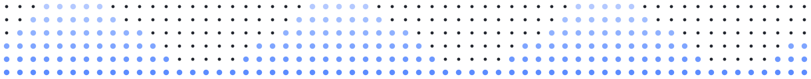

<p align="center">
  <b>A Rainbow DQN agent that learns to trade a single stock, with an optional CVaR risk penalty.</b><br>
  <sub>Did not beat buy-and-hold · PyTorch · Ashoka University RL course final project, Spring 2025, with Jiyen Khullar</sub>
</p>

### at a glance

```yaml
what:    Rainbow DQN agent that picks Buy / Sell / Hold for one stock
result:  +0.03% vs buy-and-hold +8.61% out of sample; Sharpe 0.76 vs 0.33, max drawdown 0.00% vs -27.38%
stack:   [Python, PyTorch, pandas, yfinance, Weights & Biases]
built:   Spring 2025 · Ashoka University RL course final project
status:  coursework, not maintained; the agent did not beat buy-and-hold
paper:   RL Academic Paper.pdf
```

### about

The agent is built on **Rainbow DQN** with six components: distributional RL (C51), dueling networks, prioritized experience replay, n-step bootstrapping, noisy networks and double Q-learning. The reward can be augmented with a **Conditional Value at Risk (CVaR)** penalty to train for risk-adjusted returns rather than raw profit. Experiments are tracked with [Weights & Biases](https://wandb.ai).

Methodology, theory and experimental results are in the paper: [RL Academic Paper.pdf](RL%20Academic%20Paper.pdf).

### results

Out-of-sample evaluation on the held-out test period, 15 Jun 2023 to 28 Mar 2025 (442 trading days), starting from a 100,000 balance. Figures are copied from the evaluation table printed by `RL.py` in [`output/out.log`](output/out.log) (lines 279-286).

| Metric | Agent | Buy & Hold |
|---|---|---|
| Final portfolio value | 100,031.00 | 108,605.83 |
| Total return | 0.03% | 8.61% |
| Sharpe ratio (annualised) | 0.76 | 0.33 |
| Max drawdown | 0.00% | -27.38% |

**The agent did not beat buy-and-hold.** It ended almost flat with no measurable drawdown, which is why its Sharpe ratio is higher; buy-and-hold returned 8.61% but fell 27.38% from its peak. The evaluation script does not compute a Sortino ratio, so none is reported. Plots of the same run are in `output/`.

### why these choices

- **Reinforcement learning:** trading is a sequence of `Buy`, `Sell`, `Hold` decisions that maximise a long-term objective, which RL handles by trial and error in a simulated market.
- **Dueling DQN:** learns the state value `V(s)` separately from the action advantage `A(s,a)`, useful when a state is valuable whatever the action (e.g. a strong bull market).
- **Prioritized replay:** markets have long quiet stretches and a few high-signal events (crashes, breakouts); PER focuses learning on the surprising transitions.
- **Noisy nets:** learnable noise in the weights replaces random `ε-greedy` exploration.
- **Distributional RL (C51):** learns the full return distribution, not just its mean, so the agent sees risk (variance, skew, tails) as well as expected outcome.
- **N-step returns and double Q-learning:** faster reward propagation and more stable learning.
- **CVaR penalty:** CVaR is the expected loss in the worst cases. Penalising it in the reward discourages high-drawdown strategies, aiming at better risk-adjusted performance (e.g. Sharpe). It is off by default (`cvar_penalty_factor` is `0.0`).

### run it

```bash
uv sync
uv run python RL.py
```

`RL.py` has no CLI flags: the `config` dictionary in its `if __name__ == "__main__":` block controls everything (data and output paths, `num_train_episodes`, `learning_rate`, `hidden_size`, C51 settings `v_min` / `v_max`, `cvar_penalty_factor`). The paths are set to the author's HPC directories, so change `train_data_path`, `eval_data_path` and `output_dir` to your own (`data/` and `output/` in this repo) first. Set `WANDB_MODE=disabled` to skip Weights & Biases.

<details>
<summary>layout and outputs</summary>

```
.
├── RL.py                    # environment, agent, training and evaluation, all in one script
├── RL Academic Paper.pdf    # the course paper
├── data/
│   ├── train_data.csv       # training prices
│   └── eval_data.csv        # held-out evaluation prices
├── output/                  # plots and the full-run log (out.log)
└── assets/                  # README header and footer images
```

Training prints episode-by-episode progress. The run saves performance plots (portfolio value, drawdown, actions, training performance) to the output directory, and logs them to W&B when it is enabled.

</details>

### limitations

- **Simulation only:** historical data, with no transaction costs, slippage, latency or market impact.
- **Single stock:** designed and evaluated on one stock; other assets or market conditions may differ a lot.
- **Hyperparameter sensitivity:** performance depends on the chosen hyperparameters, which may need tuning for other datasets or objectives.
- **Data snooping:** despite the train/test split, the choice of technical indicators and architecture could carry some lookahead bias.

### credits

Co-authored with Jiyen Khullar as the final project for the Reinforcement Learning course at Ashoka University, Spring 2025.


